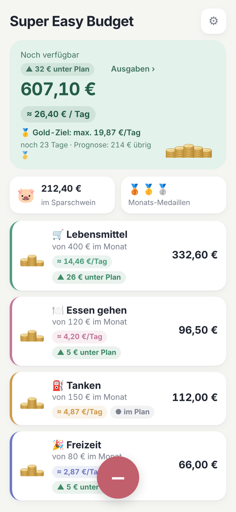
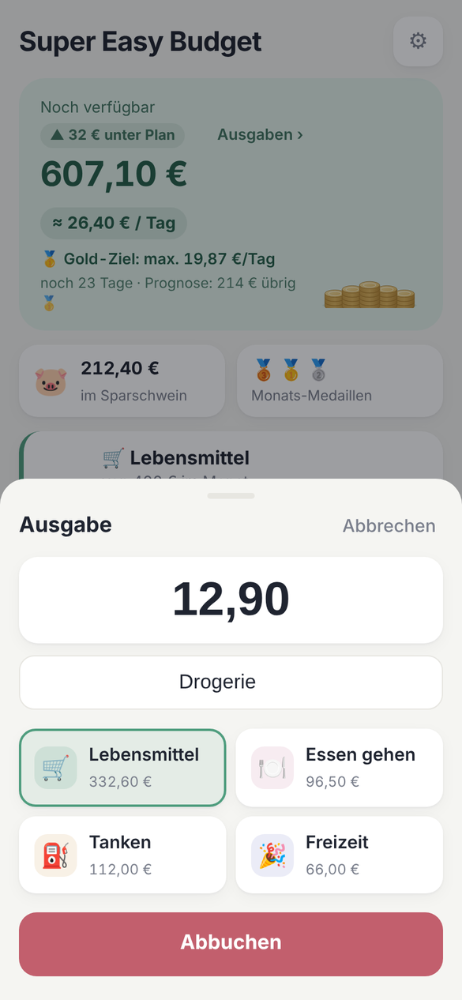
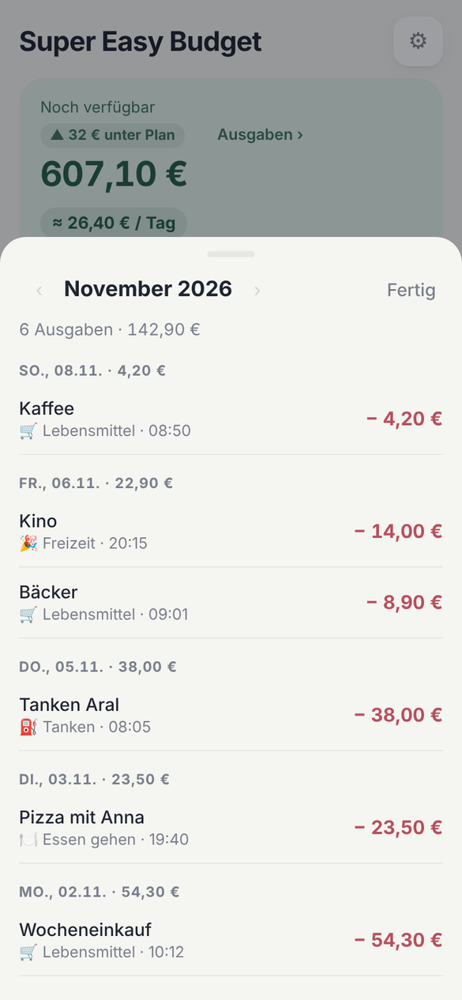
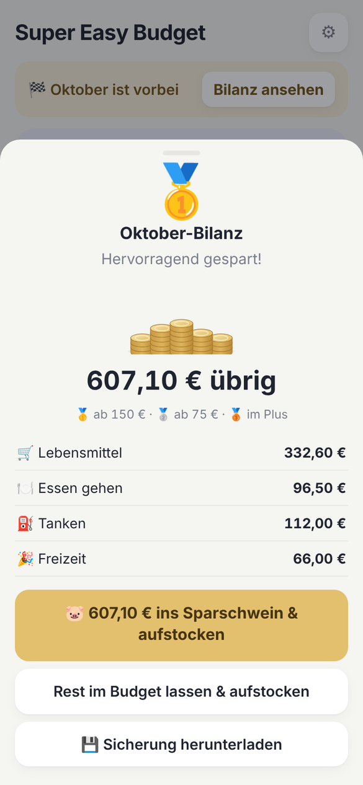
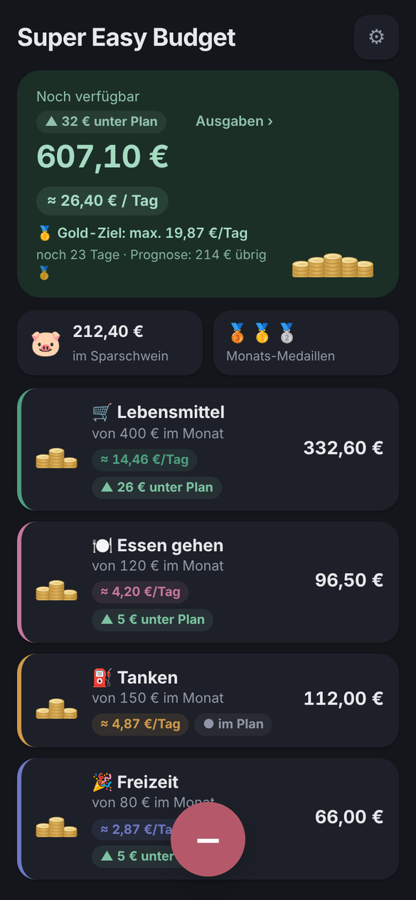

<p align="center">
  
</p>

<h1 align="center">Super Easy Budget</h1>

<p align="center">
  Budgets anlegen, Ausgaben mit einem Tipp abbuchen und sehen, wie viel pro Tag noch drin ist.<br>
  Ohne Konto, ohne Bankanbindung, ohne Cloud eines Anbieters.
</p>

<p align="center">
  
  
  
  
</p>

## Idee

Die meisten Budget-Apps wollen alles können. Super Easy Budget kann genau eine Sache: Geld in Töpfe aufteilen und Ausgaben davon abziehen. Eine Ausgabe dauert drei Tipps: **−** drücken, Betrag eingeben, Budget wählen.

## Funktionen

- **Budgets** mit monatlichem Betrag, eigener Farbe und Symbol
- **Ausgabe in Sekunden**, optional mit Notiz („Wocheneinkauf“, „Tanken“) und Vorschlägen aus früheren Notizen
- **Pro Tag verfügbar** für jedes Budget und insgesamt, bis Monatsende
- **Plan-Anzeige**: liegst du unter, im oder über Plan? Der Kopfbereich färbt sich entsprechend
- **Spar-Ansporn**: Gold-Ziel pro Tag, Prognose zum Monatsende, Monatsbilanz mit Medaillen 🥇🥈🥉 und ein Sparschwein für Restbeträge
- **Monatsübersicht** aller Ausgaben nach Tagen, auch für vergangene Monate
- **Installierbar** auf dem Handy-Home-Bildschirm, funktioniert offline, hell und dunkel
- **Optionaler Sync** über den eigenen Server, mit Zusammenführung mehrerer Geräte und täglicher Sicherung

<p align="center">
  
</p>

## Datenschutz

Alle Daten liegen im Browser auf deinem Gerät. Wenn du den Sync einschaltest, zusätzlich als eine JSON-Datei auf deinem eigenen Server. Es gibt keine Konten, keine Tracker und keine externen Dienste.

## Installation

Die App ist eine einzige HTML-Datei ohne Abhängigkeiten und ohne Build. Für Installation am Handy, Offline-Betrieb und Sync wird sie per HTTPS von einem kleinen nginx ausgeliefert.

### Proxmox-Container (automatisch)

Auf dem Proxmox-Host als root:

```bash
bash -c "$(curl -fsSL https://raw.githubusercontent.com/dieths/budget-app/main/deploy/proxmox-create-ct.sh)"
```

Das Skript lädt die aktuelle Debian-Vorlage, legt einen unprivilegierten Container an (1 Kern, 256 MB RAM, 2 GB Disk) und richtet nginx, Sync und tägliche Sicherung ein. Optionale Variablen: `CTID`, `CT_HOSTNAME`, `STORAGE`, `TMPL_STORAGE`, `BRIDGE`, `IP` (z. B. `192.168.1.50/24`), `GW`, `DISK_GB`, `MEMORY`, `BRANCH`.

```bash
CTID=120 IP=192.168.1.50/24 GW=192.168.1.1 \
bash -c "$(curl -fsSL https://raw.githubusercontent.com/dieths/budget-app/main/deploy/proxmox-create-ct.sh)"
```

### Vorhandener Debian-Container oder -Server

```bash
apt update && apt install -y git
git clone https://github.com/dieths/budget-app.git /opt/budget-app
bash /opt/budget-app/deploy/install.sh
```

Am Ende zeigt das Skript die Adresse und das **Sync-Token** an. Später abrufbar mit `cat /etc/budget-app/token`.

### HTTPS

Die App braucht HTTPS, z. B. über den Nginx Proxy Manager:

- Domain: z. B. `budget.example.com`
- Weiterleitung an `http://<Container-IP>:80`
- Let's-Encrypt-Zertifikat, „Force SSL“

Danach die Adresse am Handy öffnen und „Zum Home-Bildschirm“ wählen.

### Aktualisieren

```bash
budget-update
```

Token und Daten bleiben erhalten.

## Synchronisierung

In der App unter ⚙︎ → Synchronisierung das Token eintragen. Die App gleicht dann nach jeder Buchung, beim Öffnen und bei wiederhergestellter Verbindung ab. Offline erfasste Ausgaben werden nachgeholt. Buchungen mehrerer Geräte werden über ihre ID zusammengeführt, Budget-Änderungen nach Zeitpunkt.

Der Server sichert die Daten täglich nach `/var/lib/budget-app/backups/` und hebt sie 60 Tage auf.

Ohne Sync: regelmäßig über ⚙︎ → „Daten exportieren“ sichern. Die Monatsbilanz erinnert daran.

## Aufbau

```
app/       Die App (index.html, Service Worker, Manifest, Icons)
deploy/    Proxmox- und Installationsskript, nginx-Konfiguration
docs/      Screenshots
```

Technik: HTML, CSS und JavaScript ohne Framework · `localStorage` · Service Worker · nginx mit WebDAV-PUT für den Sync.

## Lizenz

[MIT](LICENSE)
