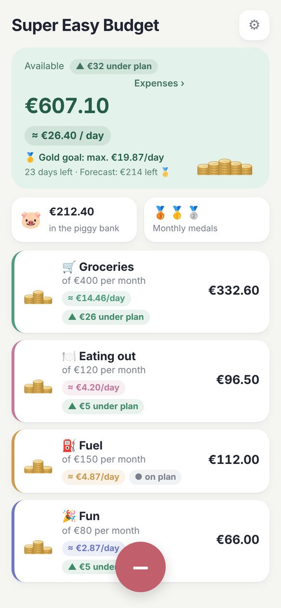
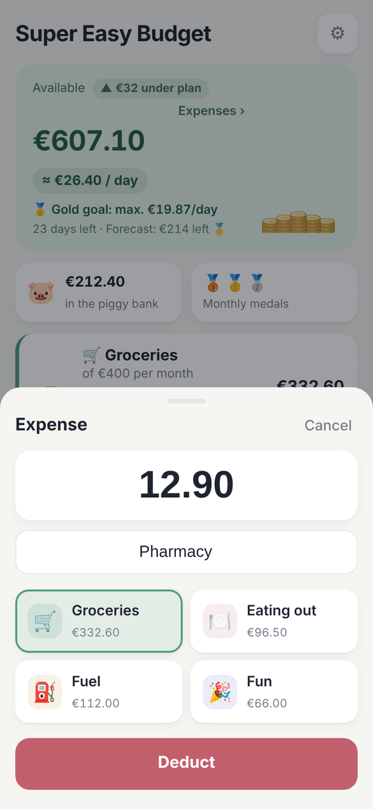
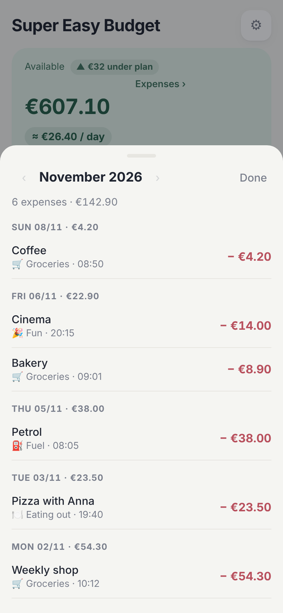
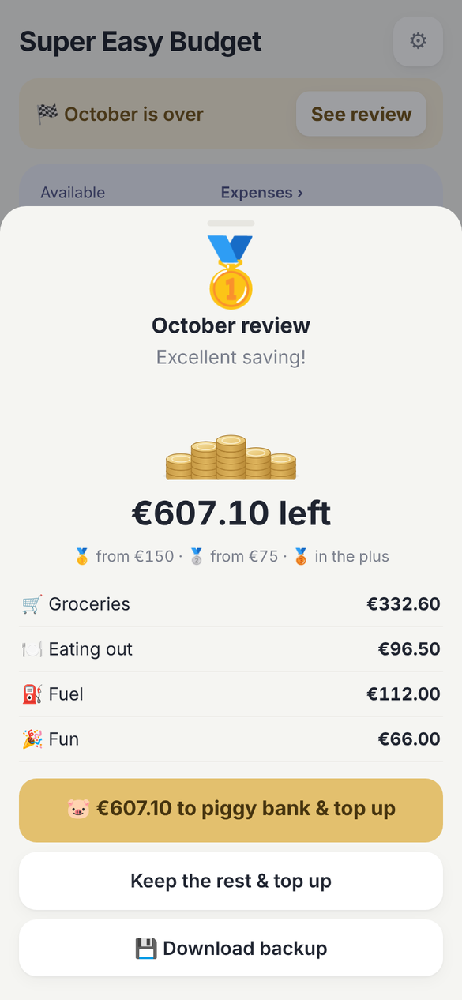
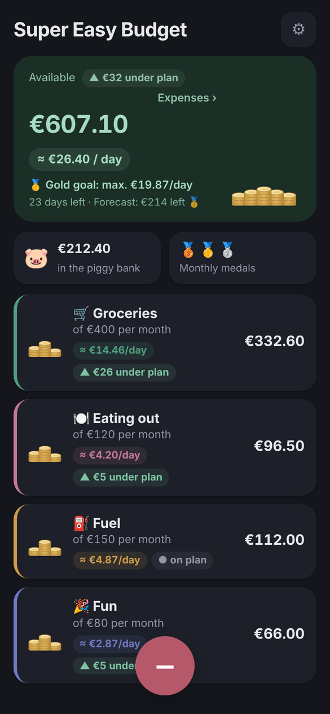

<p align="center">
  
</p>

<h1 align="center">Super Easy Budget</h1>

<p align="center"><b>English</b> · <a href="README.de.md">Deutsch</a></p>

<p align="center">
  Create budgets, log an expense in one tap and see how much you can still spend per day.<br>
  No account, no bank connection, no third-party cloud.
</p>

<p align="center">
  
  
  
  
</p>

## Idea

Most budgeting apps try to do everything. Super Easy Budget does one thing: split your money into envelopes and subtract what you spend. Logging an expense takes three taps: press **−**, enter the amount, pick the budget.

## Features

- **Budgets** with a monthly amount, their own colour and icon
- **Log an expense in seconds**, optionally with a note ("weekly shop", "petrol") and suggestions from earlier notes
- **Available per day** for each budget and in total, until the end of the month
- **Plan indicator**: are you under, on or over plan? The header changes colour to match
- **Motivation to save**: a daily gold target, an end-of-month forecast, a monthly review with medals 🥇🥈🥉 and a piggy bank for leftovers
- **Monthly overview** of all expenses grouped by day, including past months
- **Installable** on your phone's home screen, works offline, light and dark mode
- **English and German**, picked from the device language or switchable in the settings
- **Optional sync** through your own server, merging several devices, with daily backups

<p align="center">
  
</p>

## Privacy

All data lives in the browser on your device. If you turn on sync, it is also stored as a single JSON file on your own server. There are no accounts, no trackers and no external services.

## Installation

The app is a single HTML file with no dependencies and no build step. To install it on a phone, use it offline and sync, it is served over HTTPS by a small nginx.

### Proxmox container (automatic)

On the Proxmox host as root:

```bash
bash -c "$(curl -fsSL https://raw.githubusercontent.com/dieths/budget-app/main/deploy/proxmox-create-ct.sh)"
```

The script downloads the current Debian template, creates an unprivileged container (1 core, 256 MB RAM, 2 GB disk) and sets up nginx, sync and daily backups. Optional variables: `CTID`, `CT_HOSTNAME`, `STORAGE`, `TMPL_STORAGE`, `BRIDGE`, `IP` (e.g. `192.168.1.50/24`), `GW`, `DISK_GB`, `MEMORY`, `BRANCH`.

```bash
CTID=120 IP=192.168.1.50/24 GW=192.168.1.1 \
bash -c "$(curl -fsSL https://raw.githubusercontent.com/dieths/budget-app/main/deploy/proxmox-create-ct.sh)"
```

### Existing Debian container or server

```bash
apt update && apt install -y git
git clone https://github.com/dieths/budget-app.git /opt/budget-app
bash /opt/budget-app/deploy/install.sh
```

At the end the script prints the address and the **sync token**. You can show it again later with `cat /etc/budget-app/token`.

### HTTPS

The app needs HTTPS, for example via Nginx Proxy Manager:

- Domain: e.g. `budget.example.com`
- Forward to `http://<container-IP>:80`
- Let's Encrypt certificate, "Force SSL"

Then open the address on your phone and choose "Add to Home Screen".

### Updating

```bash
budget-update
```

Your token and data are kept.

## Sync

In the app, go to ⚙︎ → Sync and enter the token. The app then syncs after every change, when it is opened and when the connection comes back. Expenses logged offline are sent later. Transactions from several devices are merged by their ID, budget changes by time.

The server backs up the data daily to `/var/lib/budget-app/backups/` and keeps 60 days.

Without sync: back up regularly via ⚙︎ → "Export data". The monthly review reminds you.

## Structure

```
app/       The app (index.html, service worker, manifest, icons)
deploy/    Proxmox and install scripts, nginx configuration
docs/      Screenshots (en/de)
```

Tech: HTML, CSS and JavaScript without a framework · `localStorage` · service worker · nginx with WebDAV PUT for sync.

## License

[MIT](LICENSE)
